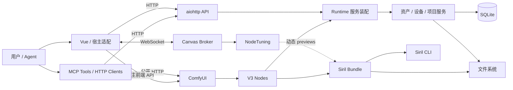
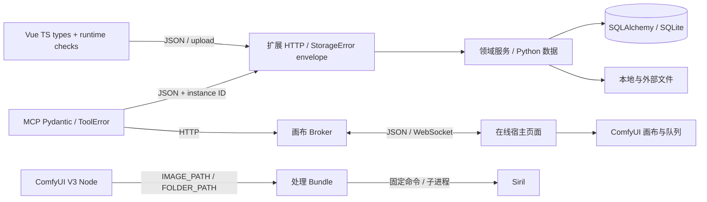
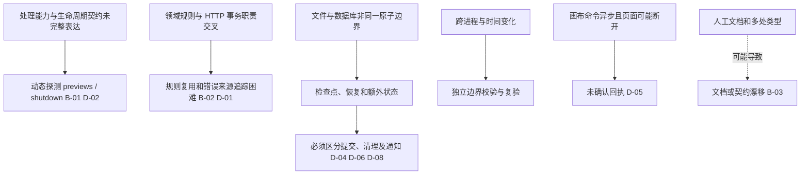

# 架构边界、数据契约与防御性编程专项调查

调查日期：2026-11-27。本文是[架构现状报告](review-2026-11-27.md)的补充，目录、初始化和基本调用链不再重复。本次只调查并编写报告，不修改业务代码、测试、配置、数据库或 Skills。

## 1. 执行摘要

扩展的业务持久化主要由后端服务与 SQLite 管理；画布和工作流由 ComfyUI 持有；浏览器、MCP 和后台任务还各有生命周期不同的暂态状态。跨进程输入、文件状态和外部程序均需要独立验证；看似重复的检查并非天然冗余。

值得优先处理的事实有四类：① 公共处理 Bundle 的声明未涵盖实际调用的预览和关闭能力；② 素材和项目的部分领域操作落在 HTTP 层，Runtime 又作为跨领域服务定位器；③ HTTP 包装器对非设备路由将部分内层编程错误类型统一映射为无日志的 `INVALID_REQUEST`，可能误导诊断；④ 画布回执、文件发布和通知各有不同的不确定性和一致性语义，不能简单当成成功或失败。治理应先确定接口契约和责任，再决定是否调整结构；不默认大规模重构。

这是一份源码与现有测试证据调查，不是完整形式化证明、漏洞评估或运行验证。文中“已确认”指行为有直接源码证据；后果如未动态复现，明确称为风险或条件性推论。

## 2. 范围、方法和覆盖情况

以当前工作树为准，其中存在与本任务无关的未提交改动；旧报告亦基于动态工作树，不代表同一固定提交。阅读 [AGENTS.md](../../AGENTS.md)、[架构](overview.md)、[产品需求](../product/requirements.md)、[领域文档](../README.md#领域)、[开发验证](../development/setup-and-testing.md)、[HTTP](../api/http/contracts.md)及 [MCP 契约](../api/mcp/contracts.md)；使用 CodeGraph 查调用和符号，结合当前源码、测试及配置核对，搜索异常、动态访问、默认值、重试和持久化约束后沿代表性路径追踪。

| 调查面 | 覆盖与主要证据 | 限制 |
| --- | --- | --- |
| 初始化、装配、数据库与配置 | [bootstrap](../../astrophoto/bootstrap.py#L53)、[Runtime](../../astrophoto/storage/runtime.py#L44)、[数据库](../../astrophoto/database/manager.py#L112)、[配置](../../astrophoto/core/config.py#L1) | 未证明所有异常后的资源释放 |
| 素材、导入、工作区、迁移与缓存 | [路径导入](../../astrophoto/assets/imports.py#L60)、[直传](../../astrophoto/assets/direct_import.py#L101)、[任务](../../astrophoto/storage/operations.py#L22)、[迁移](../../astrophoto/storage/migration.py#L1)、[缓存](../../astrophoto/storage/cache.py#L28) | 以关键状态和失败分支为样本，未逐文件证明崩溃一致性 |
| 设备、项目、分类与校准 | [设备 Schema](../../astrophoto/equipment/schemas.py#L13)、[组合](../../astrophoto/equipment/trains.py#L46)、[项目](../../astrophoto/assets/projects.py#L108)、[分类路由](../../astrophoto/api/catalog.py#L1) | 未穷尽每种分类字段与组合规则 |
| 科学节点、处理 Bundle、Siril | [来源节点](../../nodes/scientific.py#L16)、[Bundle](../../astrophoto/bundles.py#L15)、[Siril 会话](../../extension/siril/session.py#L49)、[进程](../../extension/siril/software.py#L34)、[处理](../../extension/siril/processing.py#L162) | 未运行真实 Siril；命令表各命令未逐一审计 |
| 前端、画布与宿主 | [API 客户端](../../frontend/src/api/client.ts#L12)、[画布桥](../../frontend/src/host/canvasBridge.ts#L15)、[Broker](../../astrophoto/api/canvas.py#L104)、[前端 Bundle](../../extension/siril/frontend/index.ts) | 未启动真实宿主、未穷举 UI 交互及宿主版本 |
| MCP、目标与客户端 | [服务](../../mcp/src/astrophoto_mcp/server.py#L51)、[目标](../../mcp/src/astrophoto_mcp/target.py#L80)、[HTTP 客户端](../../mcp/src/astrophoto_mcp/api/library.py#L13)、[工具](../../mcp/src/astrophoto_mcp/tools) | 未证明每个工具的所有字段与后端契约完全一致 |
| 治理、测试及开发资源 | [CI](../../.github/workflows/ci.yml)、[测试](../../tests)、[前端测试](../../frontend/tests)、[MCP 测试](../../mcp/tests)、[Feature 归档](../../.agents/features/archive) | 查阅代表性测试并核对 CI；本专项未重新执行测试或验证真实服务 |

第三方参考仓库、依赖和生成产物不作为项目自有实现。旧报告中的抽样测试结果只证明当时所列测试，不自动证明本专项的所有结论。

## 3. 架构职责与所有权

### 3.1 模块职责矩阵

| 模块 | 实际职责及对外能力 | 依赖与边界判断 |
| --- | --- | --- |
| 宿主入口 / bootstrap | V3 入口、节点绑定、`on_load` 初始化、路由及停止时资源释放，保留初始化失败状态 | 依赖 ComfyUI；符合宿主初始化时装配的意图：[入口](../../__init__.py#L27)、[bootstrap](../../astrophoto/bootstrap.py#L53) |
| `StorageRuntime` | 组装工作区、数据库、缓存、任务、素材、设备和迁移并组织恢复 | 不只是存储服务；各领域对象持有整个 Runtime 并互相获取能力，形成广泛耦合。作为组合根有价值，但字段名和注入边界不充分表达真实职责：[装配](../../astrophoto/storage/runtime.py#L44) |
| `api` | 安全检查、解析 JSON、路由、错误映射、画布协调 | [catalog](../../astrophoto/api/catalog.py#L1)也直接处理模型、关系和事务；不只是协议适配。已有[详细实例](review-2026-11-27.md#73-素材和项目的业务边界穿过-http-路由层) |
| `assets` / `equipment` | 素材、分类、项目、导入、设备和组合规则与持久操作 | 使用数据库与存储服务；[导入](../../astrophoto/assets/imports.py#L118)调用资料库规则；领域间合作本身合理，但通过 Runtime 的实际依赖宽于显式接口 |
| `storage` / `database` | 数据根、工作区、容量、任务、文件、缓存、事务和 Schema | 文件与数据库提交无法天然原子化，协调器持有检查点和恢复责任；SQLAlchemy Session 在操作内管理：[operations](../../astrophoto/storage/operations.py#L199)、[session](../../astrophoto/database/manager.py#L167) |
| 节点与 Siril | 节点适配宿主 Schema 与执行；Siril 负责命令、可执行程序、处理、预览、输出发布 | 依赖宿主节点 API、处理服务、外部 CLI 和文件系统；路径输出不等同于宿主 IMAGE：[nodes](../../nodes/scientific.py#L16)、[Siril node](../../extension/siril/node.py#L134) |
| Vue、宿主前端适配 | 页面编辑态、请求、响应检查、画布操作、Widget 与状态反馈 | 业务事实来自后端，画布事实来自宿主；前端含缓存和临时选择，并非数据库所有者：[client](../../frontend/src/api/client.ts#L12)、[canvas](../../frontend/src/host/canvas.ts) |
| 独立 MCP | 发现工具、解析 Agent 输入、目标选择、调用 HTTP、组织结果和会话句柄 | 不访问扩展业务数据库；自身任务来源记录是 MCP 状态，区别于业务库：[target](../../mcp/src/astrophoto_mcp/target.py#L53)、[client](../../mcp/src/astrophoto_mcp/api/library.py#L13) |
| Bundle 接口 | 约定装配、路由、节点和状态 | 公共节点调参和关闭还依赖未声明能力，见 B-01；无法据此认定全部 Bundle 都应拥有同样的预览能力 |

### 3.2 数据与状态所有权矩阵

| 数据 / 状态 | 权威来源与写入者 | 读取、生命周期与一致性责任 |
| --- | --- | --- |
| 设备、组合、素材、分类、项目及位置 | 扩展服务写 `assets.db`，数据库约束保护部分关系 | HTTP、节点通过服务读取，前端/MCP 通过公开 API；[数据库模型](../../astrophoto/database/catalog_models.py#L1) |
| 数据根清单、设置、revision | 扩展配置与数据根协调器写本地 JSON；不是前端状态 | 启动读取、变更时版本检查；[config](../../astrophoto/core/config.py#L1)、[数据根](../../astrophoto/storage/data_root.py#L1) |
| 实际图像与正式文件 | 文件系统；Reference 原件由外部环境控制，Copy 由工作区管理 | 数据库是位置登记，不保证文件永久存在；访问时再检查：[素材服务](../../astrophoto/assets/service.py#L1) |
| 工作区导入/迁移任务 | `StorageOperation` 行和 durable plan/receipt；`Operations` 推进 | 内存线程池仅调度；重启按持久状态恢复。后端是任务权威来源：[模型](../../astrophoto/database/models.py#L56)、[恢复](../../astrophoto/storage/operations.py#L167) |
| 浏览器直传任务与暂存 | 扩展资料库记录、暂存文件及直传服务 | 客户端负责传输，后端校验实际字节及发布；中断恢复见[直传](../../astrophoto/assets/direct_import.py#L125) |
| 画布、工作流、队列、历史 | ComfyUI 宿主及在线页面 | 前端桥维护目标和 revision，Broker 维护 session/命令回执；MCP 不拥有图：[Broker](../../astrophoto/api/canvas.py#L104)、[桥](../../frontend/src/host/canvasBridge.ts#L15) |
| 候选预览、输入引用 | Siril PreviewService 的任务、Cache 文件及 NodeTuning 内存索引 | 有 TTL、限额和源指纹；重启不保证保留；[预览](../../extension/siril/previews.py#L41)、[输入引用](../../astrophoto/api/node_tuning.py#L21) |
| 前端资源缓存、表单、轮询 | 浏览器组件 / 组合式状态 | 事件触发刷新，网络中断或通知丢失时可能暂时陈旧；[订阅](../../frontend/src/host/libraryChanges.ts#L1)、[任务](../../frontend/src/features/tasks/taskState.ts#L1) |
| MCP 目标和短期上下文 | MCP 内存选择、会话状态及独立任务来源 SQLite | 目标绑定携带实例 ID，历史来源用于重新定位，并非扩展业务库：[target](../../mcp/src/astrophoto_mcp/target.py#L53)、[session](../../mcp/src/astrophoto_mcp/tools/session_state.py#L8) |
| 聚合目录、外部进程 | 扩展聚合器 / Siril 进程 | prompt 结束清理聚合目录，进程 `finally` 杀死并等待；[aggregation](../../astrophoto/storage/aggregation.py#L1)、[CLI](../../extension/siril/software.py#L66) |

**一致性观察：**数据库提交后才发资料库变更事件；通知失败记录日志但无法回滚已提交事务，因此它是尽力通知而非可靠消息队列。不能由此认定业务写入失败，也不能保证前端立即刷新：[manager](../../astrophoto/database/manager.py#L167)、[宿主通知绑定](../../__init__.py#L61)。

## 4. 实际依赖和边界

箭头表示实际使用，不代表理想分层。Runtime 顶层导入素材/设备服务，而这些服务通过 Runtime 访问其他服务；[core 配置中的函数内导入](../../astrophoto/core/config.py#L70)、[equipment 分页相关导入](../../astrophoto/equipment/service.py#L89)及 [catalog 路由函数内导入](../../astrophoto/api/catalog.py#L361)显示已有局部双向依赖；详见[现状报告](review-2026-11-27.md#74-存在函数内导入形成的双向依赖)。延迟导入本身不证明必然发生运行时导入错误，循环影响取决于执行顺序，未在本次全图证明所有环。`TYPE_CHECKING` 引用不应视作运行时导入。

### 已有意图与实现差异

| 编号 | 设计意图与现状 | 后果及判断 |
| --- | --- | --- |
| B-01 | [Protocol](../../astrophoto/bundles.py#L15)无 `previews` / `shutdown`；[NodeTuning](../../astrophoto/api/node_tuning.py#L36)动态取预览，[关闭](../../astrophoto/storage/runtime.py#L254)动态取 shutdown；[Siril](../../extension/siril/bundle.py#L9)实际提供两者 | 已确认契约表达不完整；无预览 Bundle 的语义与停止职责应先确定。当前仅一个具体实现，未证明实际故障。高可信 |
| B-02 | 架构文档称节点和路由调用领域服务；[分类路由](../../astrophoto/api/catalog.py#L1)存在数据库模型、关系和业务处理 | 已确认职责穿透；是否迁移每个操作须结合事务和调用者，不以抽出转发函数为目标。高可信 |
| B-03 | [AGENTS](../../AGENTS.md#L3)称外部 MCP 画布桥接仍规划；[架构文档](overview.md)及[Broker](../../astrophoto/api/canvas.py#L104)已有在线页面桥 | 文档不一致；离线直接提交仍是不同能力，不能等同于已实现。高可信 |
| B-04 | `StorageRuntime` 聚合跨领域实例，领域服务经它读取彼此 | 职责广和耦合为事实；它兼具装配/共享资源作用，是否拆分需先定义生命周期和能力边界。高可信 |
| B-05 | MCP [LibraryHTTP](../../mcp/src/astrophoto_mcp/api/library.py#L101)含 catalog 与 canvas 请求，而名称指 library | 交叉职责和命名差异已确认；仅转发是否值得拆分，需考虑目标绑定和错误转换的共享责任。高可信 |

未发现的内容不等于不存在。当前证据不足以把 Reference/Copy、直传/路径导入、`/library` 与 `/catalog` 一概判定为兼容双轨；前两组有不同的输入或存储语义，后一组需按消费者及操作逐项比较。

## 5. 模块接口与跨系统契约

| 边界 / 接口 | 输入与前置条件 | 输出、失败与生命周期 |
| --- | --- | --- |
| HTTP storage handler | 可信本机请求；非 raw JSON 限长；可选实例 ID 匹配；具体 action 检查字段：[handler](../../astrophoto/api/storage.py#L300)、[security](../../astrophoto/api/security.py#L23) | 成功结果附 request ID；异常转换为状态码与错误 envelope；服务未初始化时不可用 |
| 设备 / 组合 | 必填和允许字段、规范 UUID、类型和长度；组合成员数量及去重：[schemas](../../astrophoto/equipment/schemas.py#L13) | 领域操作返回 DTO，引用和状态由服务及 DB 验证；并发或状态冲突单独报告：[trains](../../astrophoto/equipment/trains.py#L46) |
| 前端 ↔ HTTP | 请求经宿主 `fetchApi`；返回值是 `unknown`；设备等资源作运行时检查：[client](../../frontend/src/api/client.ts#L12)、[equipment](../../frontend/src/api/equipment.ts#L28) | 检查范围因端点而异；强制类型断言不能替代运行时验证，例如[项目页](../../frontend/src/features/assets/CatalogProjects.vue#L64)。未证明已出现不一致 |
| MCP ↔ HTTP | Tool 输入通过模型/工具逻辑，客户端绑定目标及实例 ID，禁止重定向和代理环境：[HTTP](../../mcp/src/astrophoto_mcp/api/library.py#L50) | 网络/超时/HTTP 转 ToolError；catalog 页面只检查关键外层字段：[catalog_request](../../mcp/src/astrophoto_mcp/api/library.py#L101)。不同客户端的类型声明与验证强度不完全相同，不等于已确认字段冲突 |
| MCP ↔ ComfyUI | 使用宿主公开 HTTP，诊断响应必须为 JSON 对象：[comfy client](../../mcp/src/astrophoto_mcp/api/comfy.py#L6) | 服务不可达或响应不符合预期为错误；画布命令还需在线页面，不保证离线工作流执行 |
| 节点 ↔ 服务 | 宿主提供 V3 输入及执行环境；来源可为素材或路径，处理在使用时访问文件：[科学节点](../../nodes/scientific.py#L16)、[FITS 解析](../../astrophoto/assets/fits.py#L18) | `IMAGE_PATH` 是文件路径而非像素数组；文件内容和可用性可在后续变化 |
| 扩展 ↔ Siril | 固定命令表，验证参数、路径和 CLI；以参数数组调用 `shell=False`：[session](../../extension/siril/session.py#L49)、[software](../../extension/siril/software.py#L34) | 退出码、日志、结果文件分别检查；超时/取消关闭进程；正式输出需经过发布登记：[processing](../../extension/siril/processing.py#L28) |
| Bundle ↔ 公共层 | Protocol 声明四项，实际另探测 preview、shutdown | `None`/缺失被当成不可用或无关闭动作，语义及必要性未完整表述，见 B-01 |
| 后端 ↔ 数据库 / 文件 | 每次 session 有事务；外键开启；文件、容量、路径和来源动态检查 | DB 原子提交不涵盖文件系统；靠暂存、身份、检查点、恢复协调：[database](../../astrophoto/database/manager.py#L73)、[直传](../../astrophoto/assets/direct_import.py#L363) |
| Canvas broker ↔ 页面 | 可信同源 WebSocket、session、command ID、目标/revision | `completed`、`rejected`、`partial`、`unconfirmed` 是不同回执；未确认不意味着未执行：[broker](../../astrophoto/api/canvas.py#L109) |

### 主要领域不变量

| 对象 | 当前保证及建立者 | 何时失效 / 不保证 |
| --- | --- | --- |
| 设备 | 类型枚举、名称长度、row_version 正值由 Schema 和数据库约束：[schemas](../../astrophoto/equipment/schemas.py#L49)、[models](../../astrophoto/database/equipment_models.py#L9) | 外部直接改库绕过应用的语义规则；约束只覆盖声明的属性 |
| 光路组合 | ID 规范、列表上限、成员去重由解析器建立；成员/状态检查在服务：[schemas](../../astrophoto/equipment/schemas.py#L67)、[trains](../../astrophoto/equipment/trains.py#L80) | 已保存的快照和当前设备值语义不同；不能视为实时镜像 |
| 素材位置 | 位置唯一性及位置形式由 DB 约束：[models](../../astrophoto/database/models.py#L36) | 文件可能移走或外盘离线；数据库行不保证路径存在、内容未变 |
| 分类与项目树 | 分类类型、关联、项目节点 kind 和相同父级名称唯一等由约束保障；项目循环与跨项目等由逻辑检查：[models](../../astrophoto/database/catalog_models.py#L100)、[projects](../../astrophoto/assets/projects.py#L108) | 跨表语义和树结构不能仅依赖外键；具体资源删除由服务处理 |
| 操作 | kind/key 唯一、支持的 kind 受 DB 约束；状态及检查点由 `Operations` 和各 worker 维护：[model](../../astrophoto/database/models.py#L56)、[operations](../../astrophoto/storage/operations.py#L117) | 提交后清理仍可能未完成；phase 与 error 要一起解释 |
| 文件与预览 | 在检查时验证路径、格式、来源状态及指纹；预览引用还有目标和时效：[FITS](../../astrophoto/assets/fits.py#L96)、[NodeTuning](../../astrophoto/api/node_tuning.py#L86) | 资源可变；预检不是永久保证，使用或发布时重新确认有独立价值 |

## 6. 信任边界与校验责任

| 输入边界 | 不可信原因 | 当前校验 / 责任 | 保证失效条件 |
| --- | --- | --- | --- |
| 用户 / HTTP | 任意 JSON、跨站请求 | [安全策略](../../astrophoto/api/security.py#L17)限制 loopback、Host、Origin、转发头和部署模式；[handler](../../astrophoto/api/storage.py#L307)限长、解析，领域 schema 验字段 | 每次请求重新鉴权；本机信任并非多用户身份认证 |
| Agent / MCP | 模型可生成错误字段或目标 | MCP 约束及 Pydantic 模型；HTTP 再验证，客户端绑定实例：[模型](../../mcp/src/astrophoto_mcp/tools/catalog_models.py#L1)、[target](../../mcp/src/astrophoto_mcp/target.py#L165) | 两个进程之间可变；不能用工具层检查取代 HTTP 边界 |
| 宿主工作流 / 节点 | 序列化值、连接和文件可变化 | V3 schema 与节点执行、文件解析和下游处理校验：[nodes](../../nodes/scientific.py#L16) | Schema 不保证文件仍存在或图未变化 |
| DB / 持久化配置 | 意外损坏、外部修改、旧开发数据库 | [数据库完整性、WAL、身份与 Schema](../../astrophoto/database/manager.py#L112)；[配置校验](../../astrophoto/core/config.py#L1) | 初始化后文件和磁盘状态仍可改变；不是历史迁移 |
| 外部文件、路径、容量 | symlink/身份变化、盘离线、空间不足、格式损坏 | [路径](../../astrophoto/storage/paths.py#L1)、[容量](../../astrophoto/storage/capacity.py#L1)、[FITS](../../astrophoto/assets/fits.py#L96)、暂存核验与发布 | 检查与使用间存在时间窗口，须结合实际检查点判断 |
| 外部 CLI | 可执行文件无效、命令/参数或进程失败 | [软件验证与 shell=False](../../extension/siril/software.py#L34)、[命令参数](../../extension/siril/session.py#L49)、[输出检查](../../extension/siril/processing.py#L42) | 路径检查和执行不是同一原子操作；本次未证明所有替换竞态可防止 |
| HTTP 响应 / 宿主 API | 网络、版本或外部实现可能不符合预期 | 前端、MCP 分别验证消费所需部分并转换错误：[frontend](../../frontend/src/api/equipment.ts#L28)、[MCP](../../mcp/src/astrophoto_mcp/api/library.py#L77) | 校验不全面的字段仍依赖隐式契约 |
| 画布 WebSocket | 页面可能断线、图变更或回执迟到 | [socket](../../astrophoto/api/canvas.py#L158)限制来源、消息和状态；页面核验目标与 revision | 超时不能证明操作没发生；不得盲目以新 ID 重试 |

### 同一数据的校验链

1. **设备 ID / 组合：** MCP 或 UI 按各自输入校验 → HTTP JSON 和领域 `id_value` → 服务查找成员与业务状态 → DB 外键和约束。前两段跨信任边界，后两段校验引用和持久一致性，不是同一检查的简单重复。[schemas](../../astrophoto/equipment/schemas.py#L37)、[service](../../astrophoto/equipment/service.py#L24)、[DB](../../astrophoto/database/manager.py#L73)。
2. **导入路径及目标：** 请求字段与来源 → 预检扫描、目标与容量规划 → 创建任务及幂等键 → worker 再检查来源/目标并暂存、核验和登记。外部文件、空间、设置可能在预检后变化，因此复验具有时间和安全职责。[imports](../../astrophoto/assets/imports.py#L67)、[operations](../../astrophoto/storage/operations.py#L42)、[直传](../../astrophoto/assets/direct_import.py#L350)。
3. **节点预览：** 页面返回节点与来源 → broker 会话绑定 → NodeTuning 验证来源和指纹并发短期 `input_ref` → 操作时校验目标、时效和输入状态 → Siril 验证参数与执行文件。[NodeTuning](../../astrophoto/api/node_tuning.py#L48)、[session](../../extension/siril/session.py#L49)。
4. **画布操作：** MCP 目标绑定 → 本地 HTTP / WebSocket 安全 → command ID 防冲突 → 页面核对目标及图版本 → 回执区分完成、部分、拒绝、未确认。[broker](../../astrophoto/api/canvas.py#L109)、[bridge](../../frontend/src/host/canvasBridge.ts#L15)。

对源码搜索发现的其他重复校验，本次没有足够证据确定哪一项可无条件删除；同字段跨信任边界或跨时间重检不应列为冗余。

## 7. 异常传播、转换与恢复

| 链路 | 产生 / 捕获 / 向外呈现 | 清理、恢复与限制 |
| --- | --- | --- |
| HTTP 同步 action | `StorageError` → [error mapper](../../astrophoto/api/errors.py#L19)；锁、DB、OS 错误分类；未知异常记录日志后 500：[handler](../../astrophoto/api/storage.py#L353) | 非设备 action 的若干 Python 异常会映射 INVALID_REQUEST，详见 D-01；映射不是恢复 |
| DB 事务及通知 | `session.begin()` 随异常退出回滚；提交后通知异常被捕获并记录：[session](../../astrophoto/database/manager.py#L167) | 通知失败不会撤销已提交事务；未见此处持久通知重试队列 |
| 后台导入/迁移 | worker 错误按异常和阶段写 error / failed / 保留 checkpoint；外层协调失败仅日志：[run](../../astrophoto/storage/operations.py#L199) | committed/publishing 等阶段保留状态以恢复；外层无法写入状态时调用方可能仍看到旧状态，需故障注入验证 |
| 直传 | 写入异常清理所属暂存并重新抛出；可确定拒绝与不确定失败采取不同清理策略：[direct](../../astrophoto/assets/direct_import.py#L363) | `BaseException` 在此是清理+传播，不是吞错；清理自身失败对原异常的影响未做动态验证 |
| Siril 进程 | 执行路径/进程/超时转换为领域错误；`finally` kill/wait；错误退出及缺失输出均失败：[software](../../extension/siril/software.py#L66)、[processing](../../extension/siril/processing.py#L28) | 子进程退出不代表输出正确，后续有结果检查；真实 CLI 与系统级故障未验证 |
| 启动 | 广泛捕获并记录异常，runtime 保持 error/degraded：[bootstrap](../../astrophoto/bootstrap.py#L53) | 这是允许宿主启动并暴露诊断的降级；不表示存储恢复成功，失败时部分资源释放需专项验证 |
| MCP / 前端 | HTTP 和解析问题映射为 ToolError / ApiError，客户端区分网络/超时：[MCP](../../mcp/src/astrophoto_mcp/api/library.py#L18)、[前端](../../frontend/src/api/client.ts#L12) | 错误 envelope 不可解析时保留 HTTP 状态、使用通用码；具体信息可能丢失 |
| 画布 | 超时或断连转 unconfirmed；页侧回执还可 partial/rejected：[broker](../../astrophoto/api/canvas.py#L109) | 这表达未知结果而非伪造成功；同 command ID 的重用和目标状态检查是重要前提 |

## 8. 防御性逻辑审计

以下列代表性或有实际影响的逻辑；“调整影响”是预期影响而非建议立即删除。测试栏列找到的相关测试，不表示该精确分支必然被覆盖。

| ID / 位置 | 行为、触发与分类 | 依据、影响、建议和前置条件 | 可信度 / 覆盖 |
| --- | --- | --- | --- |
| D-01 [handler](../../astrophoto/api/storage.py#L367) | 非设备 action 内任何 `ValueError/TypeError/KeyError/OverflowError/RecursionError` 被转 `INVALID_REQUEST`，无日志；设备路径同类错误记录日志并转内部错误。请求错误和内部缺陷均可到达该 catch | **职责不清 / 掩盖诊断风险。** action 内实现若抛这些异常，可能被归责客户端；具体线上发生率未知。先盘点哪些解析处可靠地产生领域异常，再收窄映射或增加上下文，避免破坏已承诺的 4xx；关注 [HTTP 契约](../api/http/contracts.md)。 | 行为高；实际误报中，未复现；相关 [integration](../../tests/integration/test_storage_api.py) 未证明全分支覆盖 |
| D-02 [NodeTuning](../../astrophoto/api/node_tuning.py#L36)、[shutdown](../../astrophoto/storage/runtime.py#L254) | `getattr` 探测可选 preview/shutdown，缺失时不可用或跳过；协议未声明 | **契约不完整。** 当前 Siril 提供，具体执行可达。先定义可选能力和退出契约，保留无 Bundle 的真实用途；盲目删除探测会改变可选 Bundle 行为。 | 高；[无 Bundle 集成](../../tests/integration/test_siril_api.py#L103)、[canvas](../../tests/integration/test_canvas_api.py) 关联，未证明其他 Bundle |
| D-03 [NodeTuning](../../astrophoto/api/node_tuning.py#L99) | 正式结果对齐查询遇 `StorageError/OSError/ValueError` 静默省略 `current_result`，仍返回 available 输入 | **隐式降级 / 证据不足。** 错误可由文件失效或数据问题触发；不影响输入引用本身，但调用方无法区分无结果与检查失败。先确认是否要求显示原因及异常类别，再考虑诊断；移除 catch 会改变 inspect 可用性。 | 行为高，影响中；[canvas test](../../tests/integration/test_canvas_api.py#L118)未证明全部异常类型 |
| D-04 [DB 通知](../../astrophoto/database/manager.py#L173) | 提交后广泛捕获通知异常并记录日志 | **合理异常隔离。** 已提交事务不能因通知失败回滚；可达于事件通道失败。会留下 UI 暂时陈旧风险；若要求可靠同步，先定义重连刷新或持久通知语义，不应简单重新抛异常。 | 高；[notification tests](../../tests/backend/test_library_notifications.py#L1)，本次未验证异常用例 |
| D-05 [broker](../../astrophoto/api/canvas.py#L125) | 发送失败、超时或断线得到 unconfirmed；命令 ID 与 payload 不一致则冲突 | **有依据的不确定性表达。** 操作可能已执行；当作失败并以新 ID 自动重试可能重复执行。需保留回执和查询语义。[MCP 契约](../api/mcp/canvas.md) | 高；[canvas 集成](../../tests/integration/test_canvas_api.py#L1)，未核验所有网络竞态 |
| D-06 [直传](../../astrophoto/assets/direct_import.py#L363) | `BaseException` 清理暂存和 writing 标记后重新抛出；发布拒绝与不确定失败有不同处理 | **合理资源清理。** 覆盖取消等异常并保留不确定发布的证据；去掉可能留下暂存或错误恢复。先检查清理失败是否覆盖原异常。[恢复测试](../../tests/integration/test_direct_import.py#L284) | 行为高；清理故障注入覆盖待核验 |
| D-07 [Siril](../../extension/siril/software.py#L34) | CLI 路径、名称、签名、可执行权限校验及 `shell=False`，退出/日志/输出分开检查 | **必要安全 / 外部资源检查。** 参数来自工作流或 API；检查不同属性，不能合并称重复。移除需证明等效边界。 | 高；[Siril tests](../../tests/backend/test_siril.py#L1)，真实 CLI 未运行 |
| D-08 [operations](../../astrophoto/storage/operations.py#L199) | 宽泛捕获 worker 错误并持久化阶段/错误；外层协调失败只记录日志，锁超时直接返回 | **合理任务错误转换，外层状态可观察性待验证。** 非终态检查点需要保留以避免错误恢复；若持久化失败或锁竞争，需定义何时重试及用户可见状态，避免把所有 catch 删除。 | 行为高；故障后果中；[storage tests](../../tests/backend/test_storage.py) |
| D-09 [target](../../mcp/src/astrophoto_mcp/target.py#L92) | 候选实例探测遇网络、解析或属性异常返回不可用；其他选择分支报告多实例/未发现 | **发现阶段的有界降级。** 候选本来可能不是 AstroPhoto，逐个失败应可继续；但会丢失单候选失败详情，是否需要诊断依需求。 | 高；[target tests](../../mcp/tests/test_target_discovery.py) |
| D-10 [前端 Siril](../../extension/siril/frontend/SirilNodes.tsx#L72) | Widget 值类型不符时使用命令默认值；单色参数另有处理 | **可能掩盖状态异常 / 契约待确认。** 宿主 Widget 尚未就绪或值类型异常可触发，预览参数可能不同于实际值；实际执行差异未复现。先检查宿主 Widget 生命周期和节点序列化，再决定是否反馈错误；直接删除可能破坏初始化。 | 行为高，影响中；[ScientificNodes](../../frontend/tests/components/ScientificNodes.test.ts#L104) 未证明异常 Widget 覆盖 |
| D-11 [catalog_client](../../mcp/src/astrophoto_mcp/tools/catalog_client.py#L35) | 文件路径在 `file_path`、`external_path`、`relative_path` 间选首个真值 | **多形态契约待确认。** 不同位置字段可能表示不同语义；不能仅凭多种字段认定历史兼容。核对各服务返回与工具输出承诺、相对路径解析和消费者后再调整。 | 行为高；实际冲突不足；[catalog tests](../../mcp/tests/test_catalog_tools.py) |
| D-12 [前端节点目录](../../frontend/src/api/nodes.ts#L8) | 对宿主 object info 中无效节点或输入组跳过而非全量失败 | **外部响应容错，部分结果语义需确认。** 允许部分节点可显示，但可能不提示目录缺项；宿主提供外部数据，调整前确认页面完整性要求。 | 行为高；实际影响待验证；[NodeCatalog](../../frontend/tests/components/NodeCatalog.test.ts) |
| D-13 [bootstrap](../../astrophoto/bootstrap.py#L89) | 配置错误时用默认配置对象构造 runtime，但标记 `INVALID_STORAGE_PATH` 并返回，不初始化该默认存储 | **诊断降级。** 不是静默切换数据根；删除会影响状态接口；应保留错误可见性。 | 高；[status tests](../../tests/backend/test_status.py) |
| D-14 [MCP 错误解析](../../mcp/src/astrophoto_mcp/api/library.py#L18) | 非 JSON 错误响应降为 HTTP_ERROR，保留状态；成功响应 JSON 错误则 INVALID_RESPONSE | **合理协议边界转换。** 错误体不可解析可达；会失去后端详细诊断，但不会伪造成功。 | 高；[client tests](../../mcp/tests/test_client.py) |

未证明有可无条件删除的重复校验、已废弃兼容层或自动重试缺陷。`storage/migration.py` 是用户工作区文件搬迁，不能仅凭名称判为旧 Schema migration；文件恢复检查点和停机恢复亦不等于历史版本兼容。

## 9. 架构治理机制及缺口

| 机制 | 已有约束与证据 | 缺口 / 验证边界 |
| --- | --- | --- |
| 仓库规则 | [AGENTS](../../AGENTS.md)规定业务库所有权、宿主初始化、IMAGE_PATH、软件执行边界及禁止兼容层 | 主要依靠读规则；其中画布规划描述已与实现不一致 |
| 文档与 API | [架构](overview.md)、[领域](../README.md#领域)、[HTTP](../api/http/contracts.md)、[MCP](../api/mcp/contracts.md)有职责和数据语义 | 与实现缺口见 B-01~05；文档存在不代表所有字段由机器校验 |
| 静态检查 | [CI](../../.github/workflows/ci.yml#L33)运行 vue-tsc、ESLint、Ruff 与构建检查 | 当前列出的 CI 没有明确通用模块依赖方向/循环依赖检查；不因此假定其他本地机制不存在 |
| 契约与测试 | 前端运行时校验、Pydantic、SQLite constraints；有后端、aiohttp、MCP、前端和发行测试：[CI](../../.github/workflows/ci.yml#L41) | 类型/断言分散，契约漂移仍可能；本次未逐字段交叉核验及计算覆盖率 |
| 真实集成 | 有显式宿主测试与脚本：[开发文档](../development/setup-and-testing.md#host-runtime-verification) | CI 标明 integration `not host`；本专项无真实 ComfyUI 和 Siril 验证，不能用 mock 结论代替 |
| 开发过程 | Feature 文档和审查流程：[AGENTS](../../AGENTS.md#L43)、[归档](../../.agents/features/archive) | 归档存在不证明每项代码均经过有效 review；当前工作树 Skill 有用户已有改动，不据此推断已提交状态 |
| 文档和发行检查 | [packaging tests](../../tests/packaging)、[API inventory](../../scripts/api_inventory.py)、[发布脚本](../../scripts/release.py) | 清单/导航有效不等同于语义一致；需覆盖异常和缺失值等契约 |

## 10. 根因与关联

实线表示源码支持的依赖或机制；虚线是需进一步验证的治理假设。B-01 是可证实的契约缺口，D-02 是对应动态访问；B-02 的分层问题与 D-01 的通用异常映射同时存在，但**不能证明前者单独导致后者**。文件恢复、unconfirmed 和多边界复验有真实约束，不能被归类为无依据防御。前端默认值 D-10 与字段多形态 D-11 是否产生错误，仍缺运行及产品语义证据。

## 11. 治理优先级与前置依赖

| 顺序 | 类型与内容 | 前置条件 / 不应假设 |
| --- | --- | --- |
| 1 | 确认 Bundle 可选预览、关闭及失败语义（B-01）；澄清 HTTP、服务和事务所有权（B-02）；订正画布能力描述（B-03） | 先枚举无 Bundle、Siril、节点调参和停止调用方；文档修正基于当前工作树而非旧报告 |
| 2 | 核对 HTTP 输入错误与内部错误边界（D-01）；为可复现情形保留诊断上下文 | 盘点 action 实际抛出的异常及 HTTP 状态契约；先设计有意义的错误分支测试 |
| 3 | 制定跨语言 DTO 的缺失/null/default、分页、错误和部分成功语义，核对 D-03、D-10、D-11、D-12 | 明确对应消费者与宿主 Widget 生命周期；必要时补契约测试；不预设必须引入代码生成 |
| 4 | 对文件发布/恢复、通知和任务异常做故障注入（D-04、D-06、D-08）；确认 UI 同步需求 | 明确崩溃点、时效与恢复责任；保留文件安全、检查点和已提交语义 |
| 5 | 评估 Runtime 注入宽度、MCP 客户端职责（B-04/B-05），结合真实变更决定是否拆分 | 先完成能力和生命周期契约，避免增加只有转发功能的新层 |
| 6 | 宿主与真实 Siril 的专项验证、规模基准；复核旧报告的分页风险及轮询生命周期 | 准备可重复测试环境和数据；未测性能不当作已观察故障 |

合理现状包括 loopback 安全边界、SQLite 约束、跨信任边界的校验、文件重新检查、CLI 进程清理与画布 unconfirmed；无需为统一代码风格删除。

## 12. 后续工程规范及 Skills 建议

后续制定规则时可要求：为跨模块接口明确必须/可选能力、生命周期、缺失/null 和错误语义；为状态列出权威来源与同步责任；在外部输入、时间变化和发布边界说明各次校验的独立价值；把异常传播、转换、清理、恢复和降级分开；对文件/DB 跨资源操作记录可观察的中间状态；为跨语言消费与真实宿主行为提供契约测试和明确验证范围。

工程类 Skill 可以引导逐条追踪调用方、实现和测试、收集证据并区分事实/风险/假设；不应把“删除所有 catch / fallback”“消除所有双向依赖”固化为规则。先完成实际治理设计再决定自动化形式。本次未创建或修改 Skill、检查器或工作流。

## 13. 未解决问题与证据缺口

- 未启动真实 ComfyUI、浏览器宿主或 Siril；宿主 API 版本、运行时回执、Widget 默认值及实际 CLI 错误需要在目标环境验证。
- 未穷尽全部 Siril 命令、HTTP route、MCP Tool 和前端字段；本报告的矩阵覆盖主要领域与边界，但不是逐字段完整契约证明。
- 未执行新的测试或故障注入；测试链接表明存在相关测试文件，除明确标注外不声明其覆盖精确分支。旧报告的抽样执行不代替本次动态验证。
- 未对完整依赖图做形式化循环检测，动态导入与反射可能超出静态图；所列双向关系为直接证据，不宣称其运行时失败。
- D-01 内部异常被误判的具体场景、D-03 静默省略对用户的影响、D-10 Widget 异常与正式执行是否产生差异、D-11 多路径语义冲突均待复现或确认需求。
- 启动中途失败的资源释放、通知丢失后的最终刷新、任务外层协调持久化失败、崩溃各检查点的恢复及安全竞态需要专项测试；不由代码片段推断全部安全。
- 当前工作树包含用户既有修改和删除；不同时间的文档与源码可能继续变化。后续治理应重新核对工作树和链接。
