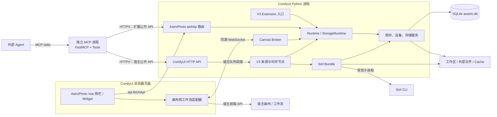
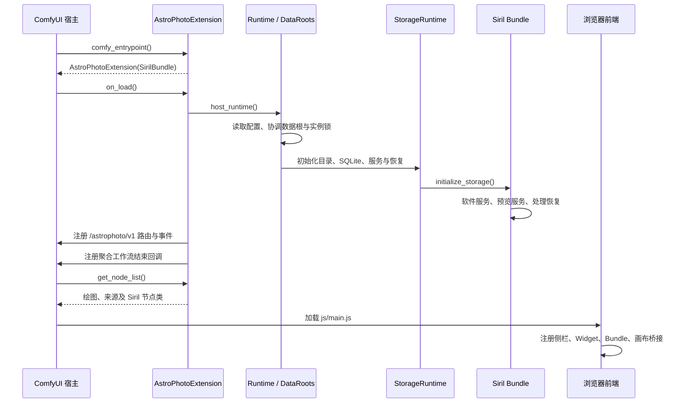
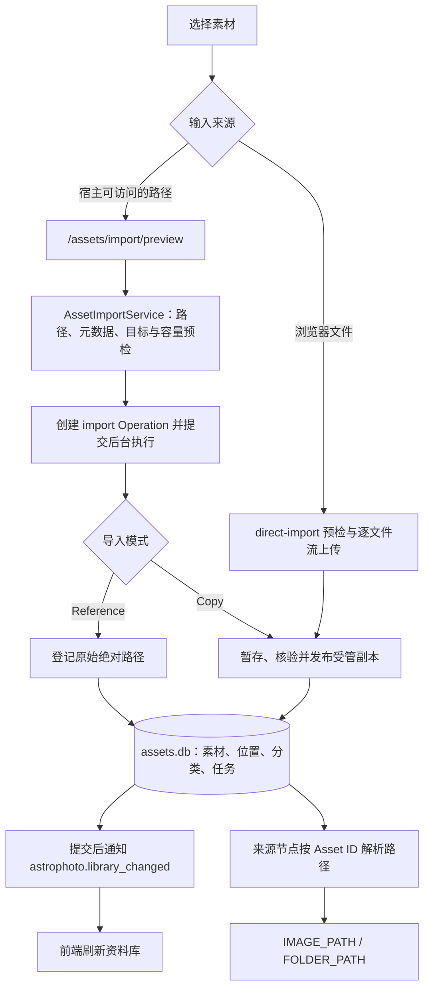
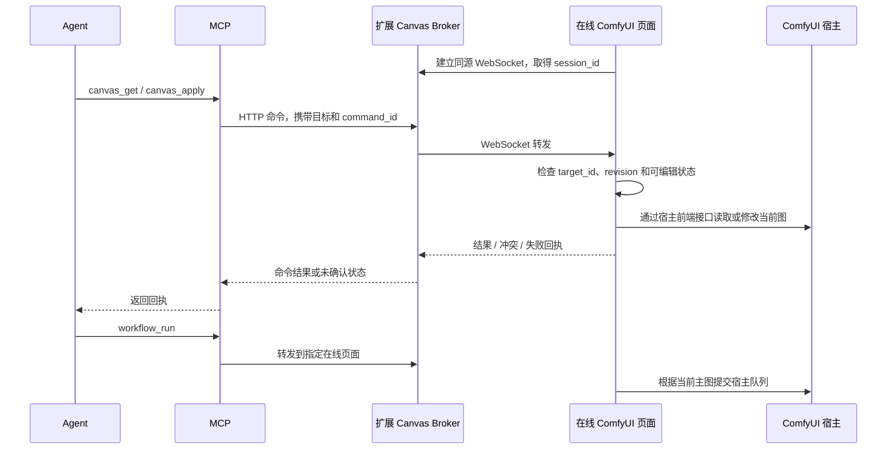

# ComfyUI-AstroPhoto 架构现状报告

审查日期：2026-11-27

后续的[架构边界、数据契约与防御性编程专项调查](boundaries-contracts-assessment-2026-11-27.md)补充了本报告的分析；两份报告均保留各自调查时的证据与验证范围。

## 1. 审查结论与范围

当前项目是一个**嵌入 ComfyUI 宿主的模块化单体扩展**，加上一个**独立启动、独立打包的 MCP 服务**。扩展后端与 ComfyUI 共用 Python 进程和 Web 服务；Vue 前端运行在 ComfyUI 页面中；MCP 通过公开 HTTP 接口与宿主及扩展通信。

已实现的主要能力包括：V3 节点注册、侧栏、数据根与工作区、素材与设备管理、Siril 节点与预览、MCP 业务工具，以及通过浏览器在线页面进行的画布桥接。知识检索、长期记忆、实验优化等仍是规划。MCP 的画布桥接**已有实现**，但工作流在前端不可用时独立提交的产品目标尚未由当前 MCP 工具覆盖。

本报告以审查时的**工作树实际内容**为准。审查开始时已有未提交修改，审查期间工作树也发生了变化，因此它不是针对某个固定提交的快照。架构调查未修改项目源码，也没有实施重构。第三方参考仓库、依赖和构建产物未作为项目自有实现审查。

主要依据：[扩展入口](../../__init__.py#L13)、[运行时装配](../../astrophoto/bootstrap.py#L89)、[MCP 服务工厂](../../mcp/src/astrophoto_mcp/server.py#L51)、[产品需求](../product/requirements.md#L37)。

### 技术栈

| 层次 | 当前实现 |
| --- | --- |
| 宿主扩展 | Python ≥ 3.11、ComfyUI V3 `ComfyExtension` / `io.ComfyNode` |
| 后端与存储 | aiohttp 路由、SQLAlchemy 2、SQLite、filelock、Astropy、Pillow |
| 前端 | Vue 3、TypeScript、`.vue` 与 Vue TSX、Vue I18n、Vite、pnpm |
| 独立 MCP | FastMCP 4.2、HTTPX、Pydantic，默认 stdio |
| 测试 | pytest、aiohttp 测试客户端、Vitest、Playwright Chromium |
| 构建与发布 | uv workspace、独立 MCP wheel、Comfy Registry 扩展包 |

前端的 `.tsx` 使用 Vue 的 `defineComponent`，不代表项目同时运行一套 React 前端。版本和依赖见[根项目配置](../../pyproject.toml)、[前端配置](../../frontend/package.json)和 [MCP 包配置](../../mcp/pyproject.toml)。

## 2. 目录结构与职责

下树展开项目主要目录及关键文件；同类文件按职责合并展示。

```text
ComfyUI-AstroPhoto/
├── __init__.py                     ComfyUI V3 入口、WEB_DIRECTORY、生命周期与节点绑定
├── pyproject.toml                  扩展元数据、uv workspace、依赖和测试配置
├── requirements.txt                源码安装依赖；发布阶段会处理本地 MCP 路径
├── README.md / DESIGN_SYSTEM.md    项目入口、前端长期设计规则
├── AGENTS.md                       仓库级 Agent 工作约束
│
├── astrophoto/                     扩展后端业务与基础设施
│   ├── bootstrap.py                Runtime 创建、存储装配、失败状态
│   ├── bundles.py                  处理 Bundle 的 Python Protocol
│   ├── core/                       配置、路径、能力状态、领域错误
│   ├── api/                        aiohttp 路由、鉴权、错误映射、画布 Broker
│   │   ├── routes.py               汇总并注册 /astrophoto/v1 路由
│   │   ├── storage.py              通用请求包装、存储及操作路由
│   │   ├── assets.py               宿主路径导入、素材路径解析
│   │   ├── direct_import.py        浏览器文件流直传
│   │   ├── library.py              素材库与 Agent 导入入口
│   │   ├── catalog.py              分类素材、校准和项目接口
│   │   ├── equipment.py            设备与设备组合接口
│   │   ├── scientific.py           FITS 来源与预览设置
│   │   ├── canvas.py               页面会话、WebSocket 命令与回执
│   │   ├── node_tuning.py          画布节点输入与候选预览协调
│   │   └── security.py / errors.py 信任边界与 HTTP 错误转换
│   ├── assets/                     素材和摄影资料库领域逻辑
│   │   ├── service.py              素材位置与路径解析
│   │   ├── imports.py              Reference / Copy 宿主路径导入
│   │   ├── direct_import.py        浏览器文件流导入及恢复
│   │   ├── library.py / catalog.py 素材查询、分类、校准和正式结果登记
│   │   ├── projects.py             项目、逻辑文件夹和素材引用
│   │   ├── fits.py                 FITS 检查、元数据与预览
│   │   └── managed_*.py 等         受管文件改名、删除、导入分组及影响检查
│   ├── equipment/                  设备、光路组合、快照、校验和分页
│   ├── database/                   SQLite 管理、ORM 模型、Schema 与触发器
│   └── storage/                    数据根、工作区、文件、容量、缓存与任务
│       ├── runtime.py              聚合各业务服务的运行时
│       ├── data_root.py            活动数据根协调及停机搬迁
│       ├── initializer.py          清单、设置、目录与初始化锁
│       ├── locations.py            工作区登记、状态、租约和路径校验
│       ├── operations.py           后台导入 / 迁移任务和恢复
│       ├── migration.py            工作区文件搬迁
│       ├── cache.py / aggregation.py
│       │                           缓存和工作流级文件聚合
│       └── manager.py / paths.py / capacity.py 等
│                                   文件操作、路径边界、容量及导入规划
│
├── nodes/
│   ├── scientific.py              文件来源、文件夹来源、文件聚合 V3 节点
│   └── ComfyUIFEExampleVueBasic.py 绘图示例节点及宿主 LoadImage 委托
│
├── extension/                     产品装配及具体处理软件 Bundle
│   ├── frontend-entry.ts          组合公共前端和 Siril 前端 Bundle
│   └── siril/
│       ├── bundle.py              注入软件服务、预览、路由和节点
│       ├── command_table.py       版本化 Siril 命令表
│       ├── commands.py            命令描述、参数与节点身份
│       ├── node.py                按命令表生成 V3 节点
│       ├── software.py            可执行文件发现、验证和进程运行
│       ├── processing.py          单 FITS 正式处理及恢复
│       ├── session.py             通用命令会话、参数和输入暂存
│       ├── previews.py            候选预览任务
│       ├── publication.py         处理结果暂存与发布
│       └── frontend/              Siril 设置、节点控件、词条与样式
│
├── frontend/
│   ├── src/
│   │   ├── main.ts                公共前端初始化
│   │   ├── api/                   扩展 HTTP 客户端与响应检查
│   │   ├── bundles/               前端 Bundle 接口
│   │   ├── host/                  ComfyUI 侧栏、Widget、画布、工作流适配
│   │   ├── features/
│   │   │   ├── assets/            素材、项目、导入与校准界面
│   │   │   ├── library/           设备及设备组合界面
│   │   │   ├── storage/           存储与环境界面
│   │   │   ├── nodes/             节点目录与预览组件
│   │   │   ├── sidebar/           侧栏装配、设置和软件入口
│   │   │   ├── tasks/             任务面板与轮询状态
│   │   │   └── drawing/           绘图示例 Widget
│   │   ├── shared/                共用组件和组合式状态
│   │   ├── i18n/ / styles/        翻译和样式
│   │   └── vendor/comfyui/        项目引用的宿主组件副本及来源说明
│   ├── tests/                     组件、Widget、宿主适配和真实宿主脚本
│   ├── scripts/                   构建边界、反向代理检查
│   └── vite.config.mts 等         构建、测试、类型与 lint 配置
│
├── mcp/                           独立发行的 MCP 包
│   ├── src/astrophoto_mcp/
│   │   ├── __main__.py / server.py CLI 与 FastMCP 装配
│   │   ├── target.py              本机实例发现、目标绑定与任务来源
│   │   ├── disclosure.py          分类发现入口
│   │   ├── api/                   扩展和宿主 HTTP 客户端
│   │   ├── tools/                 连接、设备、素材、项目、画布、工作流、节点工具
│   │   └── skills/                随 MCP 包发布的业务 Skill
│   ├── tests/                     MCP 协议、客户端、发现和业务工具测试
│   └── pyproject.toml / README.md 独立包配置与使用说明
│
├── tests/                         扩展节点、后端、集成和打包测试
├── docs/                          产品、架构、领域、API、集成与开发文档
├── scripts/                       发行、API 清单、翻译及测试数据辅助脚本
├── locales/                       宿主加载的界面和节点翻译
├── .github/workflows/             CI 与发布流程
├── .agents/
│   ├── skills/                    项目 Agent 开发技能
│   └── features/archive/          已归档 Feature 的需求、实现和验证证据
├── .codex/                        Codex 配置及产品经理 Agent 定义
├── .cursor/ / .pi/ / .vscode/     开发工具的 MCP 配置
├── benchmark/                     Pi 只读联调与检查脚本
│
├── js/                            Vite 生成的宿主加载产物；不作为源码审查
├── reference/                     第三方参考仓库；不作为项目实现审查
└── .venv/、frontend/node_modules/、
    .artifact/、.codegraph/、各种缓存
                                   依赖、运行证据、索引或生成数据
```

项目的实际构建入口是 [extension/frontend-entry.ts](../../extension/frontend-entry.ts#L1)，Vite 将其构建到 `js/`，并把 `comfy:app`、`comfy:api` 映射到宿主脚本路径。打包时 `.comfyignore` 排除前端源码、MCP 源码、测试和参考目录，同时保留扩展运行所需的 Python、`js/` 和 `locales/`。见 [Vite 配置](../../frontend/vite.config.mts)与[发行排除规则](../../.comfyignore)。

## 3. 模块关系与通信



### 主要职责

- **ComfyUI** 持有画布、工作流、节点注册、队列和执行历史。AstroPhoto 通过宿主 V3 入口及前端扩展接口接入。
- **扩展后端** 持有业务数据库、文件登记、设备和素材规则，路由挂在宿主 `PromptServer` 上，没有单独的 FastAPI/Uvicorn 服务。
- **`StorageRuntime`** 是实际的服务装配中心：它同时创建数据库、工作区、缓存、任务、素材、设备、光路、导入和搬迁服务。它的名字偏存储，但作用范围跨多个业务域。
- **Siril Bundle** 注入软件配置、预览服务、路由及节点。当前命令表有 201 项，其中 183 项脚本命令生成节点；另有 3 个公共来源/聚合节点和一个绘图示例节点。
- **前端** 负责页面状态、宿主画布操作和请求发起；业务持久化仍在扩展侧。前端 Bundle 提供 Siril 设置、节点扩展和翻译。
- **独立 MCP** 注册连接、设备、设备组合、素材、项目、画布、工作流和节点工具。通过 `list_tool_categories`、`list_category_tools`、`call_tool` 渐进发现。显式配置为非本机直连地址时，服务只注册适用的诊断能力；本机业务工具受扩展信任边界限制。

依据：[StorageRuntime](../../astrophoto/storage/runtime.py#L44)、[Siril 节点工厂](../../extension/siril/node.py#L134)、[节点注册测试](../../tests/nodes/test_registration.py#L5)、[MCP 分类发现](../../mcp/src/astrophoto_mcp/disclosure.py#L41)。

## 4. 初始化与加载机制



1. 根入口的 `comfy_entrypoint()` 创建扩展并注入 `SirilBundle`。`get_node_list()` 返回 V3 节点类给宿主注册。
2. `on_load()` 在工作线程中调用 `host_runtime()`，由 `DataRoots` 协调数据根和锁，再初始化数据库、服务和可恢复操作。
3. 初始化成功后注册路由、资料库变更事件以及聚合目录的工作流结束清理。若发现已有扩展路由，入口会复用已有运行时。
4. 初始化失败时，`Runtime` 保留错误码并进入降级状态；状态 API 仍可报告诊断。
5. 前端由统一构建入口初始化；宿主调用前端扩展 `setup` 后注册侧栏和画布桥接。存储初始化不由 UI 挂载或节点执行触发。

依据：[扩展生命周期](../../__init__.py#L27)、[存储初始化](../../astrophoto/storage/runtime.py#L70)、[前端初始化](../../frontend/src/main.ts#L14)。

## 5. 核心调用链与数据流

### 素材导入和读取



宿主路径导入支持 Reference 与 Copy；浏览器直传专门处理浏览器选择的文件流。二者共享工作区和资料库规则，但输入方式与恢复机制不同。导入操作有预检、幂等键、后台回执、容量检查和中断恢复。资料库变更在数据库事务提交后通知前端。

依据：[路径导入服务](../../astrophoto/assets/imports.py#L179)、[浏览器直传路由](../../astrophoto/api/direct_import.py#L1)、[数据库事务与通知](../../astrophoto/database/manager.py#L167)。

### 科学节点与 Siril

1. `AstroPhotoFileSource` 将素材 ID 或本机文件解析为 `IMAGE_PATH`。文件夹来源输出 `FOLDER_PATH`；子帧组作为文件集合交给聚合节点。
2. `AstroPhotoAggregate` 为当前宿主 prompt 复制文件到临时工作目录，工作流结束时释放。
3. Siril 节点由固定命令表生成。单 FITS 节点调用正式处理；通用命令节点可以通过 `SIRIL_STEPS` 组织一次处理会话。
4. 后端检查可执行文件和命令参数，暂存输入，使用 `shell=False` 启动 Siril。正式结果发布到工作区并登记正式输出；进一步收录才形成资料库素材。
5. 候选预览使用独立预览任务和 Cache。面向 MCP 的节点调参通过画布取得节点输入和版本，再调用预览服务；当前前端 Bundle 将这一能力暴露给 AutoStretch。

依据：[科学来源节点](../../nodes/scientific.py#L16)、[Siril 正式处理](../../extension/siril/processing.py#L162)、[Siril 会话校验](../../extension/siril/session.py#L49)、[进程调用](../../extension/siril/software.py#L66)、[前端 Bundle](../../extension/siril/frontend/index.ts)。

### MCP 画布与工作流



Broker 管理页面会话、命令 ID、回执及超时；前端维护当前图目标和根据图内容生成的 revision。画布修改与队列提交是不同动作。当前 `workflow_run` 需要在线页面及当前主图，MCP 还不能通过该工具直接提交一个离线提供的 API workflow。

依据：[Canvas Broker](../../astrophoto/api/canvas.py#L104)、[浏览器桥接](../../frontend/src/host/canvasBridge.ts#L15)、[MCP 画布工具](../../mcp/src/astrophoto_mcp/tools/canvas.py#L68)、[工作流工具](../../mcp/src/astrophoto_mcp/tools/workflow.py#L120)。

## 6. 数据、校验、异常和状态

### 数据与状态归属

| 状态或数据 | 实际所有者与位置 |
| --- | --- |
| 当前画布、工作流、队列、执行历史 | ComfyUI 宿主；前端适配器操作当前页面 |
| 业务实体和任务 | 扩展 SQLite `database/assets.db`，包括设备、素材、位置、项目、校准、正式输出和存储操作 |
| 大型图像 | 数据库外；Reference 保存外部路径，受管文件通过工作区及相对路径定位 |
| 配置 | 数据根 `config/manifest.json`、`settings.json` 等；设置带 revision |
| 临时文件和预览 | 扩展 Cache，宿主 temp 可作为会话缓存位置；聚合目录随 prompt 生命周期清理 |
| 浏览器页面状态 | Vue refs、模块级任务状态、部分 `localStorage` / `sessionStorage` |
| MCP 自动发现状态 | 进程内目标绑定；导入任务来源另存 MCP 自有 `tasks.sqlite3`，不读取扩展业务库 |
| 画布命令和节点候选 | Broker、前端及节点调参服务中的短期内存状态 |

默认数据根为 `~/.astrophoto/`，可通过 `ASTROPHOTO_HOME` 指定；初始工作区在 `storage/Local/`。MCP 自有任务来源库可通过 `ASTROPHOTO_MCP_STATE_DIR` 指定，属于 MCP 自身元数据。见[存储运行时](../../astrophoto/storage/runtime.py#L44)、[MCP 目标状态](../../mcp/src/astrophoto_mcp/target.py#L53)、[MCP 集成说明](../integrations/mcp.md#L17)。

### 校验与错误责任

- **入口信任边界：** 本机业务操作检查宿主是否为单用户回环部署，以及请求来源、Origin、转发头和对应本机标记。浏览器与 Agent 的资料库请求有不同检查方式。
- **HTTP 层：** 通用 `handler` 限制请求体、解析 JSON、校验目标实例，并将同步业务调用放入工作线程；领域 `StorageError` 映射为带 `request_id` 的 HTTP 错误。
- **领域层：** 设备 Schema、素材规则、路径和工作区服务分别校验字段、引用、revision、文件身份及目录边界。
- **数据库：** `session.begin()` 管理事务；初始化启用外键、WAL 等检查，并核验实例身份与当前 Schema。旧开发数据库不匹配时报告错误，要求使用新的数据根。
- **MCP：** Pydantic 约束工具输入；HTTP 客户端验证响应并将错误转成 `ToolError`。自动发现模式把一次调用绑定到确定的实例身份。
- **前端：** 请求客户端负责超时、取消、HTTP/JSON 错误和部分响应结构检查；页面负责展示表单错误、任务回执和重试。
- **外部软件：** Siril 路径、参数和输入文件在后端再次检查；预览与正式处理都有取消、检查点或恢复逻辑。

依据：[请求包装](../../astrophoto/api/storage.py#L300)、[本机安全检查](../../astrophoto/api/security.py#L23)、[错误映射](../../astrophoto/api/errors.py#L19)、[前端请求客户端](../../frontend/src/api/client.ts)。

## 7. 当前架构问题与证据

以下问题按对后续设计的影响排序。静态风险与已确认的需求缺口分别说明；架构调查没有实施修复。

### 7.1 已确认的需求缺口：离线工作流提交

产品需求要求前端不可用时仍可执行已保存或明确提交的 workflow snapshot；当前 MCP `workflow_run` 强制接收 `session_id`、`target_id` 和当前图 revision，并经在线页面提交。源码搜索未发现另一条 MCP 工具路径直接提交独立 API workflow。

这不表示 ComfyUI 宿主本身不能通过原生 API 执行 workflow；缺口位于当前 AstroPhoto MCP 工具能力。依据：[产品需求](../product/requirements.md#L120)、[当前实现](../../mcp/src/astrophoto_mcp/tools/workflow.py#L120)。

### 7.2 工作流提交依赖宿主内部队列细节

`runCanvas()` 读取 `processingQueue`、`queueItems`、`nextQueueRequestId`，临时替换队列数组的 `pop`，并包装 `graphToPrompt`、`queuePrompt` 和 `fetchApi` 以关联提交回执。代码有恢复逻辑，也有目标版本注释；但宿主队列实现变化可能影响提交和回执关联。当前浏览器测试不能替代目标版本真实宿主回归。

依据：[canvasRun.ts](../../frontend/src/host/canvasRun.ts#L5)。

### 7.3 素材和项目的业务边界穿过 HTTP 路由层

设备路由主要委托设备服务；相较之下，`api/catalog.py` 直接创建 SQL 查询、打开事务、筛选和编辑 ORM 对象，还处理分类切换、项目树和校准关联。`api/library.py` 也直接创建任务别名记录。这与架构文档中“路由调用领域服务，由服务访问存储”的描述并不完全一致。

实际影响是同一业务规则分散在 `api/` 和 `assets/`：以后增加非 HTTP 调用入口或调整事务边界时，调用方需要了解路由层内部规则。依据：[catalog 路由查询与编辑](../../astrophoto/api/catalog.py#L74)、[资料库任务别名](../../astrophoto/api/library.py#L58)、[架构意图](overview.md#L70)。

### 7.4 存在函数内导入形成的双向依赖

对 `astrophoto/`、`extension/` 和 `nodes/` 的 Python 导入做静态扫描，**未发现模块顶层导入环**；将函数内导入也计入后，发现四组双向依赖：

- `core.config` 与 `storage.manager`；
- `equipment.service` 与 `equipment.pagination`；
- `api.library` 与 `api.catalog`；
- Siril 的 `software`、`processing`、`commands`。

函数内导入使模块初始化得以避开直接的顶层环；这本身不是已经发生导入失败的证据，但表明职责和依赖方向并非严格单向。扫描不覆盖动态导入或第三方代码。

依据：[配置到存储](../../astrophoto/core/config.py#L70)、[设备分页](../../astrophoto/equipment/service.py#L89)、[API 互相导入](../../astrophoto/api/catalog.py#L361)、[Siril 软件探测](../../extension/siril/software.py#L150)。

### 7.5 Bundle 和 MCP 客户端的职责边界不完整

`ProcessingBundle` Protocol 只声明初始化、路由、节点和处理状态；公共 `NodeTuning` 却通过运行时属性读取 Bundle 的 `previews`，关闭时又以动态属性查找 `shutdown`。当前唯一的 Siril Bundle 提供这些能力，因此现有实现可工作，但 Protocol 没有表达公共调用方的完整需求。

MCP 侧也有类似的组织耦合：名为 `LibraryHTTP` 的客户端同时处理 canvas 和宿主 job；注册 canvas 工具时还顺带注册 workflow 和 node 工具。这些模块边界会让后续按能力增减或替换实现时需要额外追踪注册链。

依据：[ProcessingBundle](../../astrophoto/bundles.py#L15)、[NodeTuning](../../astrophoto/api/node_tuning.py#L27)、[LibraryHTTP](../../mcp/src/astrophoto_mcp/api/library.py#L13)、[工具注册链](../../mcp/src/astrophoto_mcp/tools/canvas.py#L173)。

### 7.6 分类目录分页存在规模风险

`api/catalog.py` 的分类列表先读取并构造候选记录，再在 Python 中筛选、排序和分页。素材页打开筛选器时又逐页读取整个分类目录。随着记录数量增加，逐页请求会重复执行全量候选构造；这是由代码结构推导出的规模风险，本次没有进行性能基准测试。

依据：[分类列表](../../astrophoto/api/catalog.py#L18)、[筛选器读取全部页](../../frontend/src/features/assets/AssetsPanel.vue#L261)。

### 7.7 前端任务轮询的生命周期需要明确

任务面板挂载时启动模块级轮询，面板卸载时只取消面板自己的请求；`stopTaskTracking()` 在当前生产源码中没有调用，只在测试清理中调用。因此侧栏 Vue 应用销毁后，模块级轮询仍可能继续，直到页面结束或其他代码显式停止。若期望后台继续通知，应明确其页面级所有权；若期望随侧栏销毁，应为该生命周期增加对应验证。

依据：[任务面板生命周期](../../frontend/src/features/tasks/TaskPanel.vue#L60)、[轮询状态](../../frontend/src/features/tasks/taskState.ts#L60)、[测试清理](../../frontend/tests/setup.ts#L4)。

### 7.8 文档与当前工作树存在偏差

- [AGENTS.md](../../AGENTS.md#L3) 仍写外部 MCP 画布桥接属于规划；当前源码和产品文档已有实现，实际限制应描述为在线页面、目标和版本约束。
- 审查时的 [AGENTS.md](../../AGENTS.md#L45) 和 [product-manager Agent 配置](../../.codex/agents/product-manager.toml#L1) 引用了 `.agents/skills/product-manager/SKILL.md`，但该文件在审查工作树中处于删除状态。这一结论包含当时的未提交改动，不能直接推断为已提交版本的问题。

### 7.9 对“多套实现”和废弃代码的判断

当前存在 `/library/assets` 与 `/catalog/...` 两组相关接口，前端也同时使用它们；它们提供的记录视图和操作范围有交集，但仍各有调用方。现有证据不足以将其中一套认定为废弃或历史兼容层，应结合具体契约再判断是否合并。

同样，`storage/migration.py` 实现的是**工作区文件搬迁**，不是旧数据库 Schema 迁移；浏览器直传与宿主路径导入服务也分别处理不同输入来源。`vue-basic` 虽来自示例工程，但仍被入口注册、需求文档和测试明确使用，不能仅凭名称将其判为死代码。Siril 的 `_dependencies.py` 存在宿主包路径与独立测试导入路径两种分支，其证据指向两种运行上下文，而非已证实的旧版本兼容。

## 8. 测试、文档和 Agent 资源

- **扩展测试：** `tests/nodes/` 检查节点注册与契约；`tests/backend/` 覆盖领域服务和文件行为；`tests/integration/` 使用真实 aiohttp 测试服务器及宿主替身，另有显式 opt-in 的真实宿主检查；`tests/packaging/` 检查发行边界。
- **前端测试：** `frontend/tests/components/` 和 `widgets/` 使用 Vitest Chromium；`frontend/tests/host/` 包含宿主适配测试和需要真实宿主的脚本。
- **MCP 测试：** `mcp/tests/` 单独测试服务注册、工具、HTTP 客户端和目标发现。
- **长期文档：** `docs/product/`、`architecture/`、`domains/`、`api/`、`integrations/` 和 `development/` 分别保存需求、架构、领域规则、接口、集成和开发流程。
- **Agent 开发资源：** `.agents/skills/` 保存开发流程和宿主参考；`.agents/features/archive/` 保存已关闭 Feature 的过程证据。MCP 的 `skills/` 是随产品发布的业务 Skill，与仓库开发技能用途不同。

依据：[CI 工作流](../../.github/workflows/ci.yml)、[开发与验证](../development/setup-and-testing.md)、[文档导航](../README.md)。

### 本次抽样验证

| 范围 | 结果 |
| --- | --- |
| Core 同步单元测试 | 6 项通过 |
| Siril 参数、路径与命令输入抽样 | 7 项通过，23 项未选 |
| V3 注册、画布 HTTP、素材 MCP 链路、存储初始化抽样 | 13 项通过 |
| MCP 服务注册与目标发现抽样 | 26 项通过，3 项未选 |
| 前端 CanvasReview 与 TaskPanel 浏览器测试 | 2 个测试文件、9 项通过 |

这些是**抽样结果，不是全量测试报告**。Python 异步测试所需的 Windows 本地套接字在受限沙箱中无法创建，重试时使用了隔离测试数据和本地测试连接。前端测试使用测试宿主；本次没有启动真实 ComfyUI、执行真实宿主工作流或复验真实 Siril CLI。因此，真实宿主兼容性、完整 `IMAGE` 下游路径和实际大规模目录性能仍以专门的宿主验证为准。
